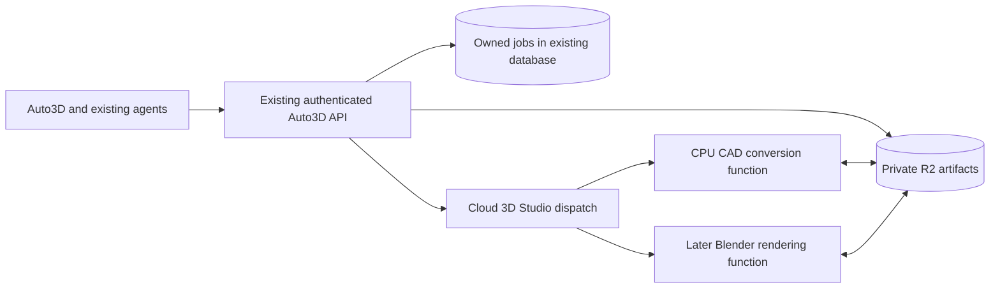

# Shared CAD conversion: goals and milestones

Updated November 17, 2026. This supersedes the Blender-first ordering while retaining Blender as a later service. **0.3.2** is live with Auto3D **0.79.0**: protected job gateway, private transfers, native proof, direct Vault provisioning and guarded reconciliation. Hosted run [44150179064](https://github.com/yuttana858/Cloud-3D-Studio/actions/runs/44150179064) passed the actual user-API calibration and cleanup; see [operations evidence](operations.md). Supplier Parasolid acceptance remains separate.

## Goals

1. Make Cloud 3D Studio the shared compute project; conversion is its first CPU service.
2. Reuse one existing Modal workspace and Auto3D's existing identity, private R2 and database. An additional Modal App itself has no separate subscription fee; metered work still consumes shared credits.
3. Convert supported Parasolid and STEP to a validated engineering STEP, browser GLB, neutral STL and explicit metadata. Keep geometry, assembly placements and physical size consistent.
4. Provide a versioned format registry so additional CAD/mesh/drawing adapters can be added without changing job ownership, lifecycle or the Auto3D connector.
5. Keep confidential inputs out of Git, container images, logs and serialized Modal Function payloads.

## Milestones and exit gates

| Milestone | Deliverable and measurable exit gate | Current status |
| --- | --- | --- |
| M0 — Architecture and scope | Shared project/workspace decision, format/units policy, staged cost policy and this milestone list committed. | Complete in this source increment. |
| M1 — Local CPU foundation, v0.1.0 | Pinned project/lockfile, capabilities, strict Parasolid/STEP adapter, bounded process, STEP/GLB/STL outputs and manifests. Synthetic boxes, inches, curved solids, assemblies, failure/limit tests pass; artifacts reopen and dimensions match. | Locally validated; see operations evidence. |
| M2 — Modal CPU proof | Securely authenticate to the intended workspace; inspect plan/credits and net-spend cap; build image and run one bounded private CPU self-test. Record commit, runtime, memory/usage where observable and validated results. | Authentication, hosted native proof and gateway checks passed. Measured billing/credit review remains operational follow-up; billing limits unchanged and no zero-cost claim. |
| M3 — Owned job connector | Auto3D API creates account-owned jobs; private source/artifact transfers, scoped worker claims, stages, retries, cancellation, expiry and reconciliation pass two-account tests. CAD bytes are not Modal Function arguments/results. | Implemented and live. Real two-account calibration and artifact validation passed; owned-job SQL/workerd fixtures cover quotas, claims, retries, cancellation and cleanup. |
| M4 — Auto3D workflow | File/unit/quality controls, correct target-window/session import, cross-scene unit normalization, one-step Undo, downloads and strict shared agent commands pass desktop/mobile checks. | Implemented and deployed in Auto3D 0.79.0 / PR #142. Desktop/mobile workflows, real GLB import and unit/history guards pass; app/module versions and exact validation are recorded in Auto3D release notes. |
| M5 — Supplier acceptance and pilot | User reference Parasolid and representative assemblies/curves pass known-dimension, count and surface checks through a private staging upload. Allowlisted-account feature flag, quotas, recovery and rollback tested. | Depends on the reference file and preceding gates. |
| M6 — Additional adapters | Introduce one format at a time using the format roadmap and a real-file acceptance corpus. No unsupported capability advertised. | Planned. |

M1 proves the native foundation locally; it does not prove cloud deployment or general Parasolid compatibility. Unsupported source schemas/surfaces can require reader work before M5. Progress and exact validation evidence belong in `operations.md`.

## Shared architecture

Use different images and resource settings for CAD and Blender, even if they belong to one Modal App. The CAD function must not pay for a GPU or load Blender merely to convert geometry. The first code increment contains a local worker and a private SDK smoke function; it intentionally does not expose a web submission route before account-scoped transfers exist.

## Cost and privacy policy

- Initial compute: two capped physical CPU cores, 4 GiB requested / 8 GiB hard-limit memory, one concurrent worker, no minimum warm containers and short idle shutdown. Benchmark before changing limits.
- Use one existing workspace. Credits are workspace-wide and shared with future render jobs. No new paid tier, workspace, GPU or billing-limit increase is part of this increment.
- Before M2, verify applicable remaining credits and the workspace's **net spend limit**. A usage budget applies before credits; it is a different control. No zero-dollar invoice is promised without verifying the account and all applicable charges.
- Modal Function inputs/results can be retained for seven days. M3 passes only expiring job references/capabilities and uses private object transfers for CAD. No source assets in images or logs; temporary directories are cleaned after jobs.
- Reuse Auto3D's identity/storage; do not create another subscription-backed database, login system or always-on API merely for conversion.

References: [Modal Apps](https://modal.com/docs/guide/apps), [pricing](https://modal.com/pricing), [budgets and spend limits](https://modal.com/docs/guide/budgets), [retention](https://modal.com/docs/guide/security).
