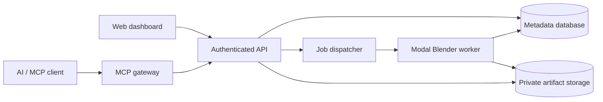

# Cloud 3D Studio: Modal deployment plan

Status: proposed implementation plan, prepared November 9, 2026. No Modal deployment has been made.

## 1. Goal and initial scope

Build a cloud service that lets a user create or upload a Blender project, modify a scene through an API or AI assistant, render on Modal, and retrieve both the result and a reusable `.blend` file.

Start with asynchronous, headless Blender workers. A browser-streamed Blender desktop is a separate feasibility milestone, not a prerequisite for the first release. Headless execution is suitable for rendering and scripted scene changes; it does not provide Blender's full interactive interface.

The first end-to-end acceptance scenario is:

1. An authenticated user creates a project.
2. A worker creates a scene containing a cube, light, camera, and material.
3. An API request changes the cube's material and transform.
4. A Modal worker renders a small PNG and saves the scene.
5. The user downloads the PNG and `.blend` file.
6. A new worker opens the saved scene and renders it successfully.

Initial defaults: one development environment, one user, CPU smoke tests, one concurrent worker, low-resolution previews, and explicit limits on execution time and output size. GPU testing requires an agreed spending ceiling. Multi-user access and production launch require the isolation and authorization gates below.

## 2. Evidence and unresolved assumptions

The selected repository is `yuttana858/Cloud-3D-Studio`. It had no remote branches or commits when inspected. This plan does not assume an existing application framework or deployment configuration.

Python HTTPS probes to `modal.com`, `modal.com/docs/guide`, and `api.modal.com` returned `Tunnel connection failed: 403 Forbidden` from this task's outbound proxy. The last observed runtime policy did not include Modal domains. These results identify a restriction in this cloud environment; they do not diagnose the user's corporate network. Another instance will verify whether the allowlist update has propagated.

The Blender MCP reference and Modal documentation could not be retrieved in this environment. Consequently, this plan does not claim that the linked MCP server is official, that it supports headless mode, or that any particular Modal transport/runtime limit has been verified. Resolve those questions before selecting implementation details or publishing operational commands.

References to verify:

- Blender MCP: <https://www.blender.org/lab/mcp-server/>
- Blender command line: <https://docs.blender.org/manual/en/latest/advanced/command_line/>
- Blender Python API: <https://docs.blender.org/api/current/>
- Modal documentation: <https://modal.com/docs/guide>
- Modal GPU guide: <https://modal.com/docs/guide/gpu>
- Modal storage guide: <https://modal.com/docs/guide/volumes>
- Modal web endpoint guide: <https://modal.com/docs/guide/webhooks>
- Modal Sandboxes: <https://modal.com/docs/guide/sandbox>
- MCP specification: <https://modelcontextprotocol.io/specification/>

## 3. Prerequisites and decisions

| Requirement | Owner | Evidence needed |
| --- | --- | --- |
| Modal workspace and billing | Project owner | Workspace selected; spending ceiling recorded |
| Network access | Environment administrator | Fresh Python HTTPS probes succeed; SDK RPC works |
| Modal credentials | Project owner | SDK authenticates to the intended workspace |
| GitHub write access | Developer | Documentation commit can be pushed |
| Blender release | Developer | Stable Linux release pinned; official checksum verified |
| SDK and Python versions | Developer | Supported combination pinned after compatibility test |
| Artifact storage | Developer and owner | Durable store selected, access and retention tested |
| User authentication | Developer and owner | Provider and single-user beta access model chosen |
| MCP implementation | Developer | Provenance, license, transport, execution model verified |

Use secure environment settings or Modal's supported login flow for credentials. Never put tokens in chat, repository files, images, URLs, or logs. Check existing bindings before requesting new ones. Do not send Modal authentication on an unrelated hostname.

No paid deployment, GPU model, monthly cost, or production domain is approved by this document. Agree on the initial test budget before running paid workloads.

## 4. Architecture



### Control plane

Use a Python API, provisionally FastAPI, for projects, versions, jobs, and authorization. Host it on Modal if the verified endpoint and persistence model fit; otherwise keep the API independently deployable while retaining compute on Modal.

The API authenticates callers, verifies ownership, validates typed operations, writes durable job records, and submits work. The MCP gateway invokes the same service layer, so it does not create a separate authorization path. Do not duplicate business rules across HTTP and MCP handlers.

### Execution plane

For the first release, run each job in a fresh Blender subprocess and isolated temporary working directory. A worker downloads a specific input version, validates the request, executes Blender in background mode, uploads artifacts, and publishes the resulting version only after all required files are complete.

Use Modal Functions for bounded jobs if their verified limits fit. Evaluate Sandboxes for advanced user scripting or interactive sessions. A new subprocess alone is not a sufficient security boundary for arbitrary user code; untrusted execution needs a dedicated isolation design and narrowly scoped credentials.

### Persistence

Store job/project metadata in a durable transactional database. Do not use container memory or a shared JSON file as the job registry. Select a managed database and verify its network/authentication path before implementing dependent operations.

Choose one authoritative artifact store. Private object storage with short-lived signed transfers is a reasonable default. Evaluate Modal Volumes as a cache or primary store only after verifying commit/reload, concurrent writer, recovery, and browser-download behavior. Do not assume a filesystem mount provides transactional project versioning.

Use immutable object keys, for example `projects/<project-id>/versions/<version-id>/scene.blend`. Store checksums, byte counts, Blender version, and dependency metadata. Keep temporary uploads separate from published artifacts.

## 5. Repository structure

Create this structure incrementally; this document does not imply these files already exist:

```text
docs/
  modal-deployment-plan.md
  operations.md
  security.md
  decisions/
src/cloud_3d_studio/
  api/                 # HTTP routes and authentication
  services/            # Shared project/job operations
  mcp/                 # MCP tools and transport adapter
  workers/             # Blender subprocess launcher
  blender/             # Scripts executed by Blender's bundled Python
  storage/             # Metadata and artifact adapters
deploy/
  modal_app.py         # Modal image, functions, secrets and environment wiring
tests/
  unit/
  integration/
  smoke/
web/                   # Added after backend workflow passes
pyproject.toml
<selected lockfile>
.env.example           # Names and safe examples only
```

Pin application dependencies in a committed lockfile. Blender has its own bundled Python; host-side packages are not automatically available inside it. Prefer JSON files or a defined process interface between the worker and Blender rather than importing the API application into Blender.

## 6. Phase A: connectivity and authentication

1. Confirm that the running instance has the updated outbound policy, not merely an edited draft.
2. Run fresh Python HTTPS requests to Modal's site and the documented API destination. An API root may legitimately return 404 or reject GET; distinguish an upstream HTTP response from a proxy tunnel denial.
3. Create a project-local Python environment and install a pinned Modal SDK from the approved package registry.
4. Verify the current official authentication procedure. Configure a development identity securely and select the intended workspace/environment explicitly.
5. Perform a documented read-only SDK operation to verify authenticated RPC. Website reachability alone does not validate the SDK's HTTP/2/gRPC path.
6. If RPC fails, capture sanitized error category, destination, TLS/proxy behavior, and timestamp. Preserve certificate verification and inherited proxy settings. Ask for only the additional destinations actually required.

**Exit gate:** authenticated SDK communication succeeds from the execution environment that will deploy the application. Record SDK/Python versions and the working procedure in `docs/operations.md`. Do not start paid workers until the budget is agreed.

## 7. Phase B: reproducible Blender image and CPU proof of concept

1. Select a stable Blender Linux build compatible with the worker architecture.
2. Download from the official distribution source, verify the official checksum, and pin release and digest in build configuration.
3. Install only required runtime libraries. Keep fonts and assets deterministic.
4. Verify `blender --version` inside the Modal image.
5. Add a Blender Python script that resets the scene, creates geometry/material/light/camera, configures a small render, and saves a `.blend` file.
6. Launch Blender with background execution, automatic script execution disabled, explicit input/output paths, and a nonzero Python exception exit code. Confirm exact flags with the pinned release.
7. Bound subprocess duration and collect stdout/stderr with redaction and truncation.
8. Retrieve the PNG and scene file. Validate image format and dimensions, then reopen the scene in a fresh process and inspect expected objects.
9. Repeat on a fresh worker to expose hidden local dependencies.

**Exit gate:** two fresh CPU workers independently produce valid artifacts; saved scenes reopen; script errors yield failed jobs rather than false success. Commit image configuration, smoke script, dependency pins, and instructions.

## 8. Phase C: GPU rendering

1. Read current Modal GPU availability, pricing, and Blender compatibility before selecting a device.
2. Configure Cycles explicitly and enumerate available render devices inside Blender.
3. Confirm that the requested GPU backend is available and selected. Log device names without exposing credentials.
4. Run a bounded representative scene. Record cold start, render duration, output dimensions, and compute usage.
5. Compare with the CPU baseline. Do not infer savings from GPU hourly rates alone.
6. Fail clearly if GPU initialization fails; allow CPU fallback only when explicitly requested and reflected in job metadata.

**Exit gate:** logs demonstrate actual GPU use and the render passes artifact checks within the approved test budget. Select preview and final-render defaults from measured results.

## 9. Phase D: durable jobs, projects, and storage

### Minimal records

- Project: ID, owner ID, display name, current version, creation time.
- Project version: ID, project ID, parent version, scene artifact, dependency manifest, checksum, Blender version, creation time.
- Job: ID, owner/project IDs, input version, operation, validated parameters, idempotency key, attempt ID, platform call reference, state, timestamps, progress, output version, error code, cancellation request.
- Artifact: ID, immutable key, media type, byte count, checksum, retention/expiry metadata.

### Required behavior

1. Create a queued record transactionally before dispatch; use an outbox or reconciliation process so a crash between database write and dispatch cannot strand the job permanently.
2. Transition `queued -> starting -> running -> succeeded | failed | canceled` with conditional updates and attempt ownership.
3. Use leases/heartbeats and reconciliation for lost workers. Do not leave jobs running forever after process termination.
4. Retry only classified transient failures, with bounded attempts. Do not automatically retry invalid scenes or scripts.
5. Make publication idempotent and protect against late completion from an obsolete attempt.
6. Upload outputs first, validate them, then commit metadata for the completed version. Clean orphaned temporary objects using retention rules.
7. Record cancellation intent, stop work through verified Modal/process mechanisms, and define how cancellation races with successful completion.
8. Use optimistic version checks or a single-writer lock to prevent lost project updates.
9. Pack or explicitly include textures and linked dependencies; reject missing references with actionable diagnostics.

**Exit gate:** a client can disconnect, reconnect, retrieve job state, download artifacts, and reopen a saved project on a new worker. Tests cover duplicate submissions, worker failure, conflicting saves, and cancellation races.

## 10. Phase E: API and authorization

Proposed endpoints:

| Method and route | Purpose |
| --- | --- |
| `POST /projects` | Create a project |
| `GET /projects/{id}` | Read authorized project metadata |
| `POST /projects/{id}/uploads` | Request a bounded, short-lived upload |
| `POST /projects/{id}/versions` | Finalize a validated uploaded scene |
| `POST /projects/{id}/jobs` | Submit an operation against an explicit version |
| `GET /jobs/{id}` | Read state, progress and sanitized error |
| `POST /jobs/{id}/cancel` | Request cancellation |
| `GET /artifacts/{id}/download` | Authorize a short-lived download |

Use a real authentication provider or a securely provisioned single-user beta identity. Derive the owner from validated identity, never from a caller-supplied owner ID. Authorize every project, job, version, and artifact request. Restrict uploads by size, expiration, and server-side validation; file extensions are insufficient.

Test unauthorized access, cross-user access, expired links, oversized requests, path traversal, malformed operations, rate limits, and repeated idempotency keys with different payloads.

**Exit gate:** a second test identity cannot enumerate, read, modify, cancel, or download the first identity's resources.

## 11. Phase F: MCP integration

First inspect the referenced Blender MCP implementation. Record repository provenance, maintainers, license, release pin, Blender compatibility, transport, authentication expectations, GUI dependencies, command execution model, and shutdown/reconnection behavior in an architecture decision record.

Choose one path based on evidence:

- Reuse it when its license, headless behavior, and security model fit.
- Place a private adapter behind the authenticated gateway when it expects a local socket or GUI session. Never expose an unauthenticated Blender socket directly to the Internet.
- Implement a small MCP gateway around the shared application service layer when the referenced server cannot support the initial headless workflow.

Use the transport supported by target MCP clients and the current specification. Verify remote authentication, session lifecycle, protocol version negotiation, and Modal endpoint timeout/streaming behavior. Do not assume compatibility with a particular ChatGPT client or plugin without testing that client.

Initial tools: `create_project`, `inspect_scene`, `list_objects`, `add_primitive`, `set_transform`, `set_material`, `set_camera`, `render_preview`, `get_job_status`, `save_project`, and `export_asset`. Each accepts typed, bounded inputs and returns structured data. Long operations return job IDs; they must not require a single tool request to stay connected until rendering finishes.

Do not expose arbitrary Python as a public default tool. If later required, isolate it as a distinct privileged capability with explicit user intent, scoped storage, restricted egress, and strict resource limits. Treat scene names and embedded metadata as untrusted content when returning them to an AI client.

**Exit gate:** a real MCP client creates or opens a project, modifies a scene, starts a render, polls status, and retrieves authorized artifacts. Connection loss and invalid tool input produce recoverable results.

## 12. Phase G: dashboard

Build the first dashboard only after the backend journey passes. Include sign-in, project list, upload, scene summary, render settings, progress, errors, preview, version history, and downloads. Polling is an acceptable initial progress mechanism; introduce streaming only when useful and verified.

Do not put provider secrets or unrestricted storage credentials into browser code. The browser talks to the authorized API and receives short-lived scoped transfers. A browser 3D viewer is optional; validate exported formats and texture handling before offering one.

**Exit gate:** a user completes the acceptance scenario without using a terminal, and reload/reconnection preserves job and project state.

## 13. Phase H: interactive Blender desktop feasibility

Treat this as a separate product decision. Prototype one authenticated user session with a virtual display, Blender UI, hardware acceleration where supported, and a browser streaming stack. Evaluate WebRTC or a WebSocket-based desktop transport only after checking current Modal support for its connection and networking requirements; do not assume public UDP or indefinite sessions are available.

Measure input latency, image quality, GPU viewport behavior, reconnect behavior, idle shutdown, maximum session duration, and hourly cost. Save project state periodically and on orderly termination, with recovery for abrupt loss. Prevent two sessions from writing the same project version concurrently.

**Decision gate:** adopt Modal for interactive sessions only if the measured experience and current platform limits fit. Otherwise run desktop sessions on a persistent remote graphics platform while retaining rendering on Modal. This does not block the headless product.

## 14. Security, reliability, and cost gates

- Treat uploaded `.blend` files, add-ons, scripts, and external asset paths as untrusted.
- Disable automatic execution of embedded scripts. This reduces risk but is not a complete defense against malicious files or native parser vulnerabilities.
- Keep Blender patched and worker credentials narrowly scoped. Avoid giving untrusted workloads database administrator or account-wide cloud credentials.
- Keep buckets private, validate archive extraction paths, and restrict asset retrieval to approved destinations to limit SSRF and unexpected downloads.
- Apply per-user concurrency, resolution, sample count, runtime, upload, storage, and daily usage limits. Enforce limits server-side, including MCP requests.
- Start with no always-on workers unless explicitly needed. Verify actual Modal scaling defaults and caps rather than assuming idle compute is free.
- Record per-job compute time, device class, storage, and transfer metrics. Estimate cost from current published rates; do not promise a fixed monthly bill without workload measurements.
- Test backup restoration, deletion, retention, and artifact expiration. Redact secrets and signed URLs from logs.

No production launch until authorization, isolation, failure recovery, and spending controls pass. No full-desktop promise until its feasibility gate passes.

## 15. Deployment and operations procedure

1. Create separate development and production Modal environments, identities, secrets, metadata stores, and artifact namespaces.
2. Pin the SDK, Blender release/checksum, base image, and application dependencies. Record the source commit in every deployment and job.
3. Run local unit checks and the CPU integration smoke test. Use Modal's currently documented development execution command for the chosen app layout.
4. Deploy to development using the current supported CLI. The exact CLI invocation belongs in the operations guide after it has been executed successfully; this plan does not label untested commands as working.
5. Verify health separately from functional readiness: submit an authenticated smoke job, inspect its state transitions, download artifacts, and reopen the scene.
6. Run the bounded GPU check only when approved and needed.
7. Promote the same verified source/image configuration to production. Apply compatible database migrations through a controlled release step.
8. Verify a production smoke job and monitor startup failures, queue age, duration, cancellation, artifact publication, and cost.
9. Keep the previous deployable source/image available. On failure, stop new submissions if needed, roll back application code, and reconcile in-flight jobs. Do not roll back database state blindly.

GitHub CI can initially run lint/type checks and unit tests without Modal credentials. Add deployment automation only after manual development deployment works. Use supported short-lived identity if available; otherwise store a narrowly scoped deployment token in GitHub's secure settings. Do not run credentialed deployments for untrusted pull requests. Production deployment should have an explicit release gate.

Future development tasks should use the existing isolated checkout; do not create worktrees unless explicitly requested. Development servers and authenticated sessions must be restarted as documented rather than assumed to survive environment snapshots.

## 16. Validation matrix

| Check | Expected evidence | Required milestone |
| --- | --- | --- |
| HTTPS + authenticated SDK RPC | Upstream reachability and correct workspace | Connectivity |
| CPU render | Valid image and saved scene on fresh worker | Proof of concept |
| GPU render | Selected GPU device and valid output within budget | GPU support |
| Reopen project | New process reads scene and dependencies | Persistence |
| Disconnect/reconnect | Durable job status and artifacts remain accessible | Job API |
| Retry/idempotency | One published result; obsolete attempts cannot overwrite | Job API |
| Worker termination | Lease expires and job is reconciled | Reliability |
| Cross-user access | Every resource rejects unauthorized identity | Private beta |
| MCP journey | Actual target client completes tool workflow | MCP release |
| Restore/deletion | Backup restores; retention removes intended artifacts | Production |
| Interactive session | Measured latency, recovery, acceleration and cost | Desktop only |

## 17. Execution checklist and handoff

- [ ] Verify allowlist propagation from the deployment instance.
- [ ] Verify official Blender MCP source and current Modal documentation.
- [ ] Configure Modal authentication securely and select the workspace.
- [ ] Agree on a test spending ceiling.
- [ ] Add pinned Python project configuration and Modal CPU worker.
- [ ] Render, retrieve, and reopen the first scene.
- [ ] Benchmark a bounded GPU job.
- [ ] Select and validate metadata and artifact storage.
- [ ] Implement durable jobs, authorization, and recovery.
- [ ] Add and test the MCP gateway with the actual target client.
- [ ] Build the dashboard.
- [ ] Pass private-beta isolation and usage-limit checks.
- [ ] Document deployment, rollback, credential rotation, and restoration.
- [ ] Evaluate the interactive desktop separately.

The immediate next implementation task is the connectivity/authentication gate followed by the CPU Blender proof of concept. It should produce a working deployment module, pinned dependencies, an example scene script, a meaningful smoke test, and tested operational instructions. The current deliverable is this plan; application code, Modal deployment, GPU validation, and production readiness remain unimplemented.
